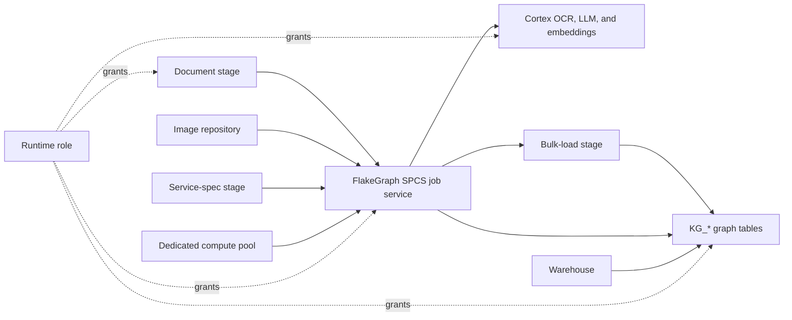
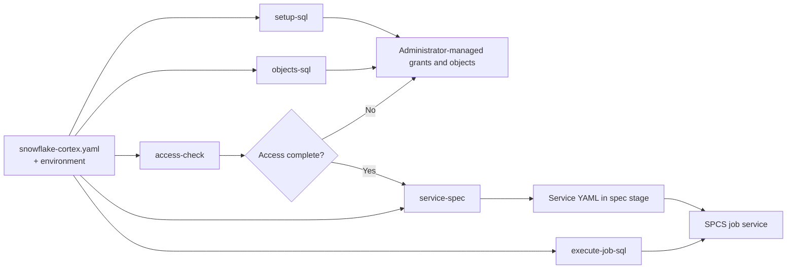
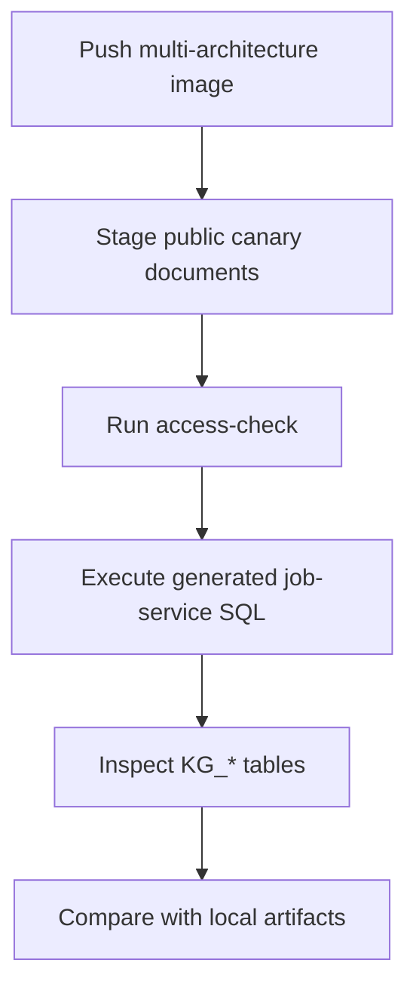

# Snowflake Setup

This guide is intentionally account-neutral. Use it as a checklist for a target
Snowflake account, but do not commit real account locators, user emails, role
names from private tenants, image digests, stage listings, or access-audit
transcripts back to the repository.

FlakeGraph can run locally without Snowflake. Snowflake mode uses the same
pipeline with Snowflake stages, Cortex, Snowflake tables, and Snowpark Container
Services.

The [console](../react/README.md), deployed on Snowflake App Runtime, provides
stage upload and listing, queue submission, per-run SPCS launch, live
`KG_JOB_FILE` progress, graph sharing, and graph exploration. It is a control
plane; the launched SPCS worker remains responsible for OCR, extraction,
embedding, and graph writes. See [Console on App Runtime](#console-on-app-runtime).



## Required Objects

A production deployment needs the objects shown above: a runtime role,
warehouse, database/schema, three purpose-specific stages, image repository,
and dedicated Snowpark Container Services compute pool.

Avoid relying on account-provided system compute pools for job services. Create
or grant a dedicated service-compatible pool such as `KG_PROCESSOR_CPU_POOL`.

## Minimum Grants

| Scope | Required capability |
| --- | --- |
| Warehouse, database, schema, compute pool | `USAGE` |
| Input document stage | `READ` |
| Bulk-load and service-spec stages | `READ`, `WRITE` |
| Image repository | `READ`, `WRITE` |
| Deployment schema | `CREATE TABLE`, `CREATE STAGE`, `CREATE IMAGE REPOSITORY`, and `CREATE SERVICE` when the runtime role owns setup |
| Graph tables | `SELECT`, `INSERT`, `UPDATE`, and `DELETE` (these privileges cover `MERGE`) |
| Cortex | `SNOWFLAKE.CORTEX_USER` on the calling user's **default role**, plus required account AI grants (see [Cortex REST API](#cortex-rest-api)) |
| Compute pool | `CREATE COMPUTE POOL ON ACCOUNT` or `USAGE` on a pre-created pool |

## Cortex REST API

Model completions and embeddings use the Cortex REST API
([overview](https://docs.snowflake.com/en/user-guide/snowflake-cortex/cortex-rest-api)):
`POST /api/v2/cortex/inference:complete` with the same
`{"type": "json", "schema": ...}` structured output as `AI_COMPLETE`
([structured outputs](https://docs.snowflake.com/en/user-guide/snowflake-cortex/complete-structured-outputs)),
and `POST /api/v2/cortex/inference:embed`
([embedding API](https://docs.snowflake.com/en/user-guide/snowflake-cortex/cortex-rest-api/embed-api)).
REST calls need no warehouse. A SQL `AI_COMPLETE` is a warehouse query that holds
a concurrency slot while the model works, so concurrent extraction would queue
every other statement on that warehouse behind model calls; the warehouse carries
only document parsing, queue, cache, and graph-write statements.
`AI_PARSE_DOCUMENT` stays in SQL: it runs once per document and has no REST form.

The OpenAI-compatible `/api/v2/cortex/v1/chat/completions` endpoint is not used.
It ignores `response_format` for models outside the Claude and OpenAI families,
which would drop strict structured output for models such as `mistral-large2`.

Requirements the documentation states:

- REST requests run as the calling user's **default role**, not the session role
  a connection selects. That role needs `SNOWFLAKE.CORTEX_USER` (granted to
  `PUBLIC` by default) or `SNOWFLAKE.CORTEX_REST_API_USER` (REST only, never
  granted to `PUBLIC`). Inside SPCS the service user's default role is the
  service owner role.
- The account must allow the Cortex REST API. HTTP 403 means either this or a
  default role without the grant.
- Rate limits apply per account and per model, in tokens and requests per
  minute, and answer with HTTP 429. The embedding endpoint is limited to 200
  requests and 400,000 tokens per minute, takes at most 1,280 texts per request,
  and at most 4,096 characters per text. Raising `KG_EMBED_BATCH_SIZE` toward
  1,280 spends fewer of those requests. The limits in force are in
  `SNOWFLAKE.ACCOUNT_USAGE.CORTEX_REST_API_RATE_LIMIT_POLICIES`, and per-request
  usage in `CORTEX_REST_API_USAGE_HISTORY`.

Rate limits, server errors, and dropped connections are retried with bounded
backoff that honours `Retry-After`. Each attempt is bounded by the configured LLM
or embedding timeout from first byte to last.

Authentication follows the connection settings:

| Where | Credential | Headers |
| --- | --- | --- |
| SPCS (`authenticator: oauth`) | The OAuth token at `snowflake.oauth_token_path`, read again for every request because SPCS rotates it, sent to `SNOWFLAKE_HOST` | `Authorization: Bearer <token>`, `X-Snowflake-Authorization-Token-Type: OAUTH` |
| Anywhere else | One connector sign-in with the configured password, key pair, browser SSO, or programmatic access token, whose session token every thread reuses | `Authorization: Snowflake Token="<session token>"` |

A session token that Snowflake reports as expired (code `390112`) is renewed by
signing in again, and the session is also replaced hourly.

## Configuration

Start from [configs/snowflake-cortex.yaml](../configs/snowflake-cortex.yaml) and
provide account-specific values through environment variables:

```bash
export KG_SNOWFLAKE_ACCOUNT="your-org-your-account"
export KG_SNOWFLAKE_USER="your-user"
export KG_SNOWFLAKE_AUTHENTICATOR="externalbrowser"
export KG_SNOWFLAKE_DATABASE="KG_DB"
export KG_SNOWFLAKE_SCHEMA="GRAPH"
export KG_SNOWFLAKE_ROLE="KG_PROCESSOR_ROLE"
export KG_SNOWFLAKE_WAREHOUSE="KG_PROCESSOR_WH"
export KG_SNOWFLAKE_STAGE="@KG_DB.GRAPH.KG_DOCS"
export KG_SNOWFLAKE_BULK_STAGE="@KG_DB.GRAPH.KG_LOAD_STAGE"
export KG_SNOWFLAKE_IMAGE_REPOSITORY="KG_DB.GRAPH.KG_IMAGES"
export KG_SNOWFLAKE_IMAGE_NAME="flakegraph:0.1.0"
export KG_SNOWFLAKE_COMPUTE_POOL="KG_PROCESSOR_CPU_POOL"
export KG_SNOWFLAKE_SERVICE_NAME="KG_PROCESSOR_JOB"
export KG_SNOWFLAKE_SERVICE_SPEC_STAGE="@KG_DB.GRAPH.KG_SERVICE_SPECS"
export KG_JOB_LEASE_OWNER="flakegraph-worker-1"
export KG_STAGE_PREFIX="incoming"
export KG_LLM_MODEL="llama3.3-70b"
export KG_EMBED_MODEL="snowflake-arctic-embed-l-v2.0"
export KG_EMBED_DIM="1024"
```

Set `KG_SNOWFLAKE_IMAGE_DIGEST` to the pushed `sha256:<64-hex-digest>` before
rendering production service SQL. Set
`KG_SNOWFLAKE_COMPUTE_POOL_INSTANCE_FAMILY` only when `setup-sql` should create
the pool; omit it when an administrator has already provisioned the named pool.
`KG_JOB_LEASE_OWNER` must identify the worker uniquely whenever more than one
file-queue worker can run concurrently.

For unattended Snowpark Container Services runs, prefer OAuth file auth inside
the container or key-pair auth for a dedicated service user. Keep private keys,
OAuth tokens, passwords, and generated session tokens outside Git.

Browser SSO re-authenticates on every connection, which interrupts multi-step
deployment sequences with repeated browser prompts. Set
`KG_SNOWFLAKE_STORE_TEMPORARY_CREDENTIAL=true` to reuse a cached token instead.
It requires a keyring backend, which the connector treats as optional:

```bash
uv sync --extra sso-cache
```

Without that extra the connector warns and continues to prompt. The setting is
opt-in because caching writes a short-lived token to the operating system
credential store. It has no effect inside SPCS, where the mounted OAuth token
already avoids interactive authentication.

## Document Identity

Snowflake reports its own MD5 for staged files. Every other file source records a
SHA-256 of the bytes, so adopting the provider value would give one document two
identities depending on which runtime ingested it, and any comparison that binds
a document by checksum — including gold-fixture evidence grounding — would fail
for reasons unrelated to extraction quality.

Staged files are therefore read once to produce the same content hash as
elsewhere, and Snowflake's value is retained separately as provenance. Set
`KG_STAGE_CONTENT_HASH=false` to skip that read where cross-runtime comparison
and gold evaluation are not needed; the recorded checksum is then Snowflake's
own and is not comparable with other sources.

## Node Aliases

Each `snowflake_direct` or `snowflake_bulk` write rebuilds a graph's
`KG_NODE.ALIASES` from the `KG_ENTITY_SOURCE.ALIASES` of the documents that
support each node, so a document's aliases leave the graph together with the
document.

## Build And Push The SPCS Image

SPCS requires a `linux/amd64` image. Cortex supplies OCR and model
inference, so exclude the larger local OCR and embedding dependencies from this
image; the console the image also carries is simply not run. Disable BuildKit
provenance to push a single image manifest that SPCS can pull directly:

```bash
docker buildx build \
  --platform linux/amd64 \
  --provenance=false \
  --load \
  --build-arg KG_INSTALL_MINERU=false \
  --build-arg KG_INSTALL_LOCAL_EMBEDDINGS=false \
  --build-arg KG_PRELOAD_LOCAL_EMBEDDING=false \
  --tag flakegraph:snowflake .

snow spcs image-registry login
REGISTRY="$(snow spcs image-registry url)"
docker tag flakegraph:snowflake \
  "$REGISTRY/kg_db/graph/kg_images/flakegraph:0.1.0"
docker push "$REGISTRY/kg_db/graph/kg_images/flakegraph:0.1.0"
```

Use `snow spcs image-repository list-images KG_DB.GRAPH.KG_IMAGES` to read the
uploaded digest, then set `KG_SNOWFLAKE_IMAGE_DIGEST` before rendering the
service spec. Pinning that digest makes each run reproducible even if a tag is
later reused.

## Generated SQL And Specs

Render the account setup and runtime artifacts locally before applying them:

```bash
uv run flakegraph snowflake setup-sql --config configs/snowflake-cortex.yaml
uv run flakegraph snowflake objects-sql --config configs/snowflake-cortex.yaml
uv run flakegraph snowflake access-check --config configs/snowflake-cortex.yaml
uv run flakegraph snowflake submit --config configs/snowflake-cortex.yaml
uv run flakegraph snowflake service-spec --config configs/snowflake-cortex.yaml
uv run flakegraph snowflake execute-job-sql --config configs/snowflake-cortex.yaml
```

`setup-sql` includes role/grant-oriented statements. `objects-sql` renders only
schema objects and is safer for environments where administrators manage grants
separately. `submit` lists the configured document stage and idempotently creates
the `KG_JOB_FILE` queue rows that SPCS workers claim. It does not invoke Cortex
or start the compute pool, so review its reported file count before executing the
job service.

The generated service spec embeds the complete effective processing
configuration as a compact, secret-free runtime payload. This preserves graph,
OCR, embedding, ontology, and finalization settings selected by a CLI or app run
instead of falling back to defaults baked into the image. Local passwords,
tokens, private keys, and external-provider credentials are excluded; SPCS
supplies its scoped Snowflake OAuth token at runtime, and explicit container
environment variables retain highest precedence.

By default, `access-check` makes three deliberately small Cortex calls: an
eight-token completion and one embedding through the REST API, and the first
page of one staged PDF through `AI_PARSE_DOCUMENT`. These canaries catch model,
grant, region, REST-enablement, and account-tier restrictions before SPCS
starts. They reuse the access check's own session, so they run as the signed-in
user's default role rather than the SPCS service user's. Use `--skip-cortex`
when an object-only, non-AI audit is required.



## Console On App Runtime

The console is a Next.js application that Snowflake App Runtime builds and
serves inside the account, behind Snowflake sign-in. It is the same console the
Kubernetes fleet serves, told by `FLAKEGRAPH_SNOWFLAKE_HOSTED=1` in `react/app.yml`
that the Sf-Context headers are Snowflake's ingress speaking.

Deploy it from `react/` with Snowflake CLI 3.31 or later:

```bash
export FLAKEGRAPH_SNOWFLAKE_APP=FLAKEGRAPH
export FLAKEGRAPH_SNOWFLAKE_DATABASE=YOUR_DATABASE
export FLAKEGRAPH_SNOWFLAKE_SCHEMA=YOUR_SCHEMA
export FLAKEGRAPH_SNOWFLAKE_WAREHOUSE=YOUR_WAREHOUSE
export FLAKEGRAPH_SNOWFLAKE_OPERATORS=YOUR_USER,YOUR_ADMIN_ROLE
bun scripts/deploy-snowflake.ts -c YOUR_CONNECTION
```

`FLAKEGRAPH_SNOWFLAKE_OPERATORS` becomes `FLAKEGRAPH_APP_OPERATORS` on the
service: the users and roles who may change what every session sees. Leave it
unset and nobody can.

The script stages the console with `configs/app-defaults.yaml` and the
ontology profiles, fills the account names into `app.yml`, and runs
`snow app deploy`. Snowflake builds the package remotely, stores it in a
`<APP>_REPO` artifact repository, and creates or alters the application service.
The command prints the service URL, which stays stable across deployments.

Deploy into the schema that holds the `KG_*` tables. Without the account
administrator's App Runtime setup, `snow app deploy` falls back to the
deployer's personal database, where an application cannot be shared. A role
that owns the target schema can deploy there without that setup.

How the running console uses the account:

- Every query runs with the service owner's rights, the same role that owns the
  `KG_*` tables, stages, and job services. The console enforces graph ownership
  and sharing itself through `KG_GRAPH.OWNER` and `KG_GRAPH_ACL`. Lists filter in
  SQL, and anything naming one graph or run reads those two tables first.
- A graph belongs to whoever first submitted a run of it. Its owner shares it
  with a user, or with a role as `role:NAME`, at read or write; only the owner
  shares or deletes it. A graph nobody has claimed, such as one written by the
  CLI, stays open to everyone who can sign in to the console.
- Snowflake identifies the signed-in user in the `Sf-Context-Current-User`
  request header, and nobody can assume another identity. The console reads that
  user's roles with a caller's-rights query, which needs no `CALLER` grants
  because it reads no tables; any roles header is ignored.
- The ingress ends any request after about 90 seconds, including streamed
  responses. Run progress is polled, and submission returns as soon as the
  asynchronous job service starts.
- Uploads wait on the service's local disk until their run is submitted, so
  `app.yml` keeps the service at one instance. Each goes to the document stage
  under `app/<USER>/<run>`, which only that user may name as a source, with its
  folders kept. The worker reads stage paths of letters, digits and `_ . = $ -`
  only, so anything else in a file or folder name lands as `_`.
- What the console keeps for itself rather than in `KG_*` tables lives on that
  disk too and goes when the service restarts: API keys, uploaded gold files,
  saved perspectives and reviews.
- Graph questions need a model the question pipeline can call, and it does not
  call Cortex, so the Ask tab is not offered.
- The service suspends after an hour without requests and resumes on the next
  one.

To let other users open the console, grant their role usage on the database,
the schema, and the service:

```sql
GRANT USAGE ON DATABASE YOUR_DATABASE TO ROLE YOUR_VIEWER_ROLE;
GRANT USAGE ON SCHEMA YOUR_DATABASE.YOUR_SCHEMA TO ROLE YOUR_VIEWER_ROLE;
GRANT USAGE ON APPLICATION SERVICE YOUR_DATABASE.YOUR_SCHEMA.FLAKEGRAPH TO ROLE YOUR_VIEWER_ROLE;
```

### Graph Table Schema

The worker runs the schema's idempotent statements when it writes a graph, so
a role that owns the tables applies them with its first run. The console reads
every column from the moment it is deployed, so apply them first:
`flakegraph snowflake ddl` renders the whole idempotent set.

```bash
uv run flakegraph snowflake ddl --config configs/snowflake-cortex.yaml
```

Preflight names a required table that is missing. A `VECTOR` column keeps the
width it was created with whatever the statements say; preflight compares that
width with the run's embedding model.

## Live Validation

Once the account objects and grants exist:

1. Push the Docker image to the configured Snowflake image repository.
2. Upload or stage at least one public test document under the configured stage
   prefix.
3. Run `uv run flakegraph snowflake access-check --config configs/snowflake-cortex.yaml`.
4. Run `uv run flakegraph snowflake submit --config configs/snowflake-cortex.yaml` and verify
   the queued file count.
5. Execute the rendered job-service SQL.
6. Inspect the `KG_*` tables or export local artifacts for parity comparison.

The repository keeps live Snowflake tests opt-in. Set `KG_RUN_SNOWFLAKE_LIVE=1`
only in an environment where the required account values and permissions are
provided externally.



## Materialize graph tables for local review

Export the current graph tables and the matching run diagnostics with:

```bash
flakegraph snowflake export --graph-id <graph-id> --job-id <job-id> \
  --output out/kg --config <config.yaml>
```

The local `run_report.json` and `graph_metrics.json` retain consumption and
quality diagnostics. If one job has several diagnostic pairs, select its
batch/content run with `--run-id`. Without selectors the diagnostics are
exported when the graph holds exactly one job/run pair; a graph with several,
or with no diagnostic tables, exports its graph tables with empty diagnostics.
Selectors that match several pairs or none are refused. The selectors choose
diagnostics; they do not recreate a historical graph-table snapshot.
